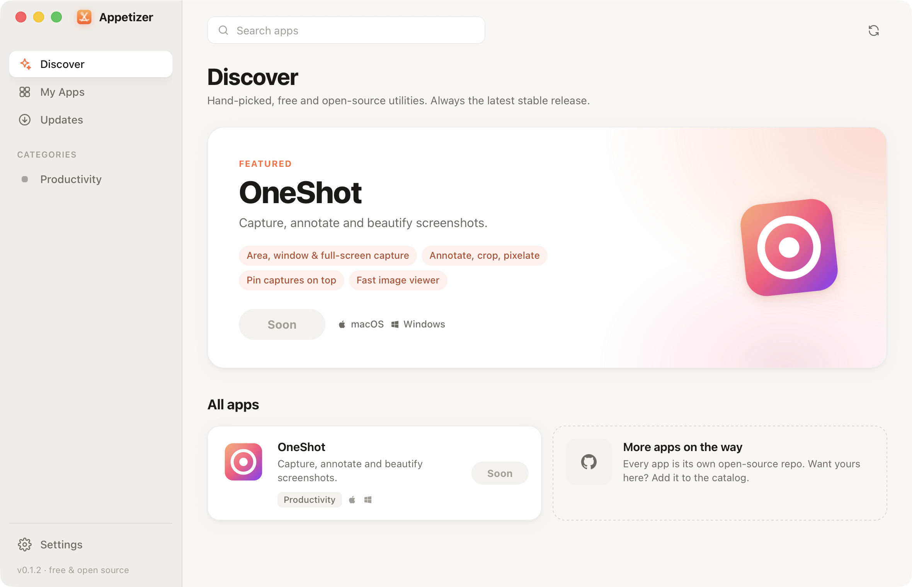

<p align="center"></p>

# Appetizer

**Free, open-source utility apps for your Mac, Windows or Linux PC, in one place.** Browse a hand-picked collection, install with one click, and Appetizer keeps everything up to date. No account, no subscription.



> **Status:** early (v0.1.x). Available now: [OneShot](https://github.com/fabianfreund/OneShot), a screenshot tool, and [Clockodile](https://github.com/fabianfreund/Clockodile), a time tracker. YapTap (local dictation) and WTF (a viewer and converter for any file) are coming soon.

## Download

Get the latest version from [Releases](https://github.com/fabianfreund/Appetizer-launcher/releases/latest):

| | |
|---|---|
| **macOS** | `Appetizer_…_universal.dmg`, signed and notarized, for Apple Silicon and Intel |
| **Windows** | `Appetizer_…_x64-setup.exe` |
| **Linux** | `Appetizer_…_amd64.AppImage`, `.deb` or `.rpm` |

## Highlights

- **One-click installs:** pick an app, press Get. Appetizer downloads the right version for your system and installs it.
- **Always up to date:** apps update themselves in the background as soon as a new version is out. Appetizer updates itself too.
- **Open source, all the way:** every app lives in its own public GitHub repo, and Appetizer only installs their official stable releases.
- **Finds what you have:** apps you installed before are recognized, so they can be updated from here.
- **Feels at home:** light and dark mode, and a native look on every system.

## The apps

| App | What it does | Platforms |
|---|---|---|
| [OneShot](https://github.com/fabianfreund/OneShot) | Capture, annotate and beautify screenshots | macOS, Windows, Linux |
| [Clockodile](https://github.com/fabianfreund/Clockodile) | Track time, bill clients, export clean PDF timesheets | macOS, Windows, Linux |
| [YapTap](https://github.com/fabianfreund/YapTap) | Hold a key, talk, let go: fully local dictation *(coming soon)* | macOS, Windows, Linux |
| [WTF](https://github.com/fabianfreund/WTF) | Open any file. View, edit and convert it *(coming soon)* | macOS, Windows, Linux |

Want your app in Appetizer? Every app is a public GitHub repo with normal releases. See [Adding apps](docs/ADDING-APPS.md).

## Support

Appetizer and its apps are free. If they save you time, you can [buy me a coffee](https://buymeacoffee.com/fabianbuilds) ☕

## Build from source

```bash
pnpm install
pnpm app        # run the desktop app
```

You need Node 22+, pnpm and Rust. See [Developing Appetizer](docs/DEVELOPMENT.md) for how it works and how releases are made.

## License

[MIT](LICENSE). Appetizer is not affiliated with Setapp or any other app store.
